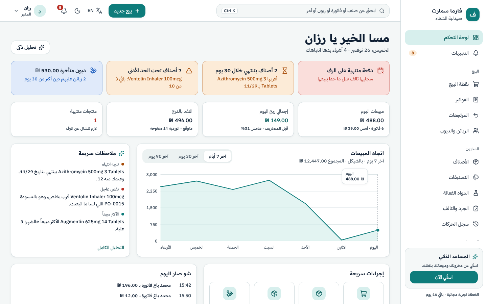
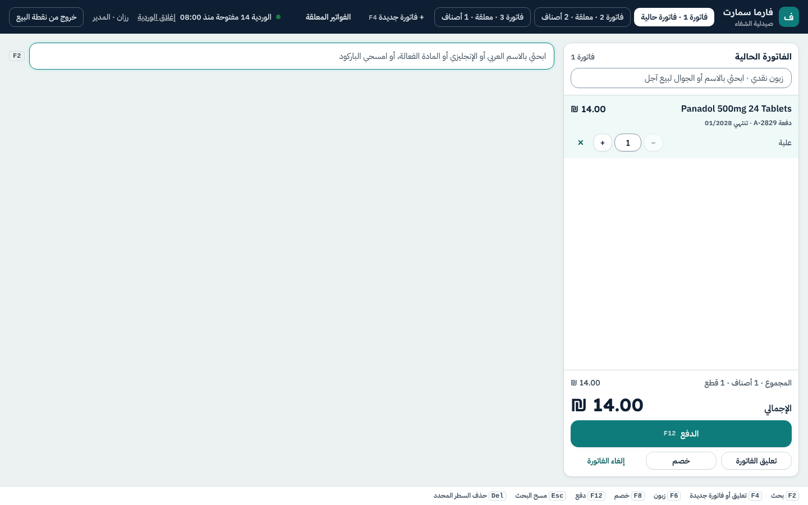
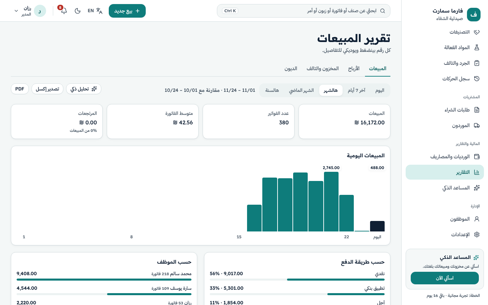
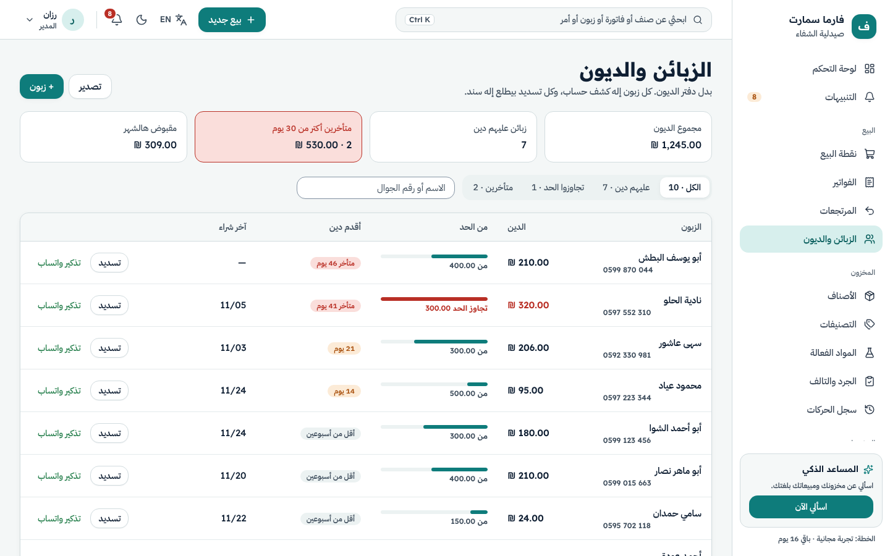
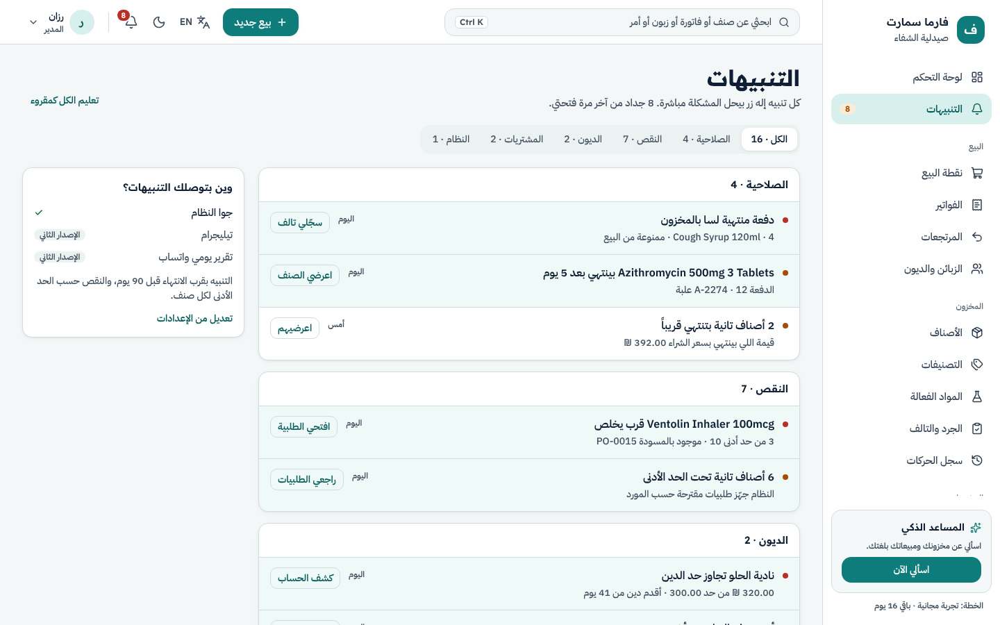
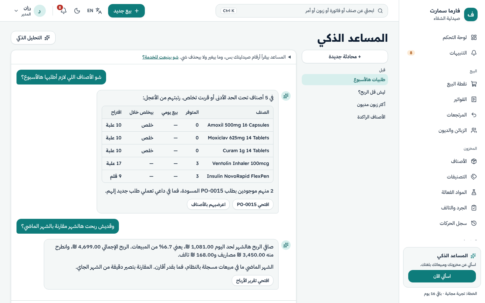
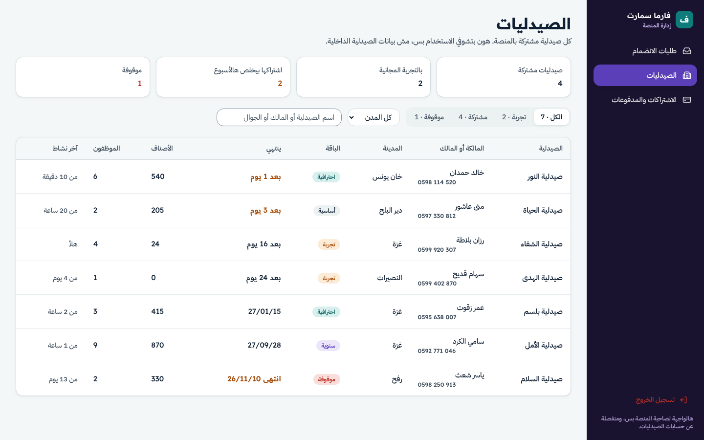
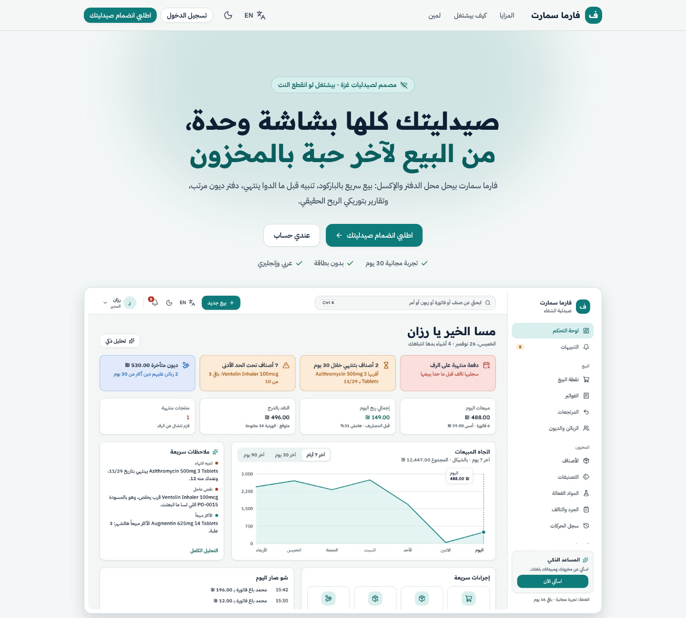

# فارما سمارت

نظام لإدارة الصيدليات: البيع، والمخزون والصلاحية، والمشتريات، وديون الزبائن، والورديات، والتقارير، ومساعد ذكي. ولوحة لصاحبة المنصة بتدير فيها الصيدليات المشتركة.

هاد المستودع هو الواجهة. بتشتغل بالعربي والإنجليزي، بالوضع النهاري والليلي، وعلى الكمبيوتر والجوال.



---

## المحتويات

1. [المشكلة](#المشكلة)
2. [الحل](#الحل)
3. [مين بيستخدمه](#مين-بيستخدمه)
4. [الشاشات](#الشاشات)
5. [المشروع بالأرقام](#المشروع-بالأرقام)
6. [التقنيات](#التقنيات)
7. [الهيكلية](#الهيكلية)
8. [التشغيل](#التشغيل)
9. [الباك إند والسيرفر الوهمي](#الباك-إند-والسيرفر-الوهمي)
10. [الجودة](#الجودة)
11. [التوثيق](#التوثيق)
12. [شو لسا](#شو-لسا)
13. [الأسرار](#الأسرار)

---

## المشكلة

أغلب الصيدليات الصغيرة بغزة بتشتغل بدفتر وآلة حاسبة، أو بإكسل بأحسن الأحوال. وهاد بيعمل مشاكل يومية:

| المشكلة               | شو بيصير                                                                      |
| --------------------- | ----------------------------------------------------------------------------- |
| الدوا بينتهي على الرف | ما حدا بيعرف شو قرب ينتهي لحد ما يصير تالف. خسارة مصاري، وخطر إنه ينباع منتهي |
| النواقص بتنكشف متأخر  | الزبون بيطلب، والدوا خالص، والطلبية ما انعملت                                 |
| دفتر الديون           | بيضيع، وبينكتب فيه غلط، وما حدا بيعرف مين صار متأخر                           |
| الدرج آخر اليوم       | فرق بالمصاري، وما في طريقة تعرفي من وين                                       |
| الربح الحقيقي مجهول   | بيعرفوا كم باعوا، بس مش كم ضل بعد التكلفة والمصاريف والتالف                   |
| النت والكهربا         | بينقطعوا، والبيع لازم يكمل                                                    |

والبرامج الموجودة يا غالية، يا بالإنجليزي، يا معقدة، يا مش مصممة لصيدلية صغيرة.

---

## الحل

نظام واحد بالعربي، سهل، وبيشتغل من المتصفح، بيحط كل هاد بمكان واحد:

| الجزء             | شو بيحل                                                                                |
| ----------------- | -------------------------------------------------------------------------------------- |
| **نقطة البيع**    | بيع سريع بالكيبورد والماسح، بالعلبة أو الشريط أو الحبة، ومن الدفعة الأقرب للانتهاء أول |
| **الصلاحية**      | كل دفعة بتاريخها. المنتهي ممنوع من البيع، واللي قرب ينتهي بيطلع تنبيه                  |
| **النواقص**       | الحد الأدنى لكل صنف، وطلبيات مقترحة جاهزة حسب المورد                                   |
| **الديون**        | حساب لكل زبون، والدين محسوب من الحركات مش رقم محفوظ. عمر الدين وتذكير واتساب           |
| **الورديات**      | الدرج بينعدّ بالفتح والإغلاق، والنظام بيحسب شو لازم يكون فيه، والفرق بسبب               |
| **الأرباح**       | من المبيعات لصافي الربح خطوة خطوة، بتكلفة الدفعة اللي انباعت فعلاً                      |
| **التنبيهات**     | كل تنبيه إله زر بيحل المشكلة، وبيختفي لحاله لما تنحل                                   |
| **المساعد الذكي** | أسئلة بكلام عادي عن أرقام الصيدلية، بدون ما يطلع أي اسم زبون برا                       |
| **بدون نت**       | البنية جاهزة: البيع بيتسجل بالجهاز وبينرفع لما يرجع النت                               |

---

## مين بيستخدمه

| الدور        | شو بيشوف                                                                          |
| ------------ | --------------------------------------------------------------------------------- |
| المديرة      | كل شي: الأرقام والأرباح والمصاريف والموظفين والإعدادات                            |
| الصيدلي      | البيع والأصناف والمخزون والمشتريات والتقارير، بدون الأرباح والمصاريف              |
| الكاشير      | البيع والفواتير والمرتجعات والزبائن بس                                            |
| صاحبة المنصة | الصيدليات المشتركة وطلبات الانضمام والاشتراكات، بالأعداد بس، بدون أسرار الصيدليات |

الصلاحيات بتنفحص مرتين: الواجهة بتخبي اللي مش إلك، والسيرفر بيرفضه لو انطلب.

---

## الشاشات

المشروع مبني على 12 وحدة، كل وحدة بملف شرح كامل:

| الوحدة                    | الشاشات                                                                                                    |
| ------------------------- | ---------------------------------------------------------------------------------------------------------- |
| 0. الأساس                 | نظام التصميم، المكونات، اللغتين، الوضعين، الاتصال، السيرفر الوهمي                                          |
| 1. الدخول والبداية        | الدخول، نسيت كلمة المرور، طلب الانضمام، التفعيل، تجهيز الصيدلية، قائمة البداية                             |
| 2. الموظفون والإعدادات    | الموظفون وصلاحياتهم، سجل النشاط، الإعدادات                                                                 |
| 3. الأصناف                | الأصناف، صفحة الصنف، إضافة وتعديل، التعديل الجماعي، الاستيراد من إكسل، الملصقات، التصنيفات، المواد الفعالة |
| 4. المشتريات              | الموردون، كشف المورد، طلبات الشراء، الطلبيات المقترحة، الاستلام                                            |
| 5. المخزون                | الجرد، التالف، سجل الحركات                                                                                 |
| 6. البيع                  | الوردية، نقطة البيع، الدفع والإيصال، الفواتير، المرتجعات                                                   |
| 7. الزبائن والديون        | الزبائن، كشف الحساب، التسديد                                                                               |
| 8. الورديات والمصاريف     | سجل الورديات، المصاريف                                                                                     |
| 9. لوحة التحكم والتنبيهات | لوحة المديرة والصيدلي والكاشير، مركز التنبيهات، قائمة الجرس                                                |
| 10. التقارير والمساعد     | تقارير المبيعات والأرباح والمخزون والديون، المساعد الذكي، التحليل الذكي                                    |
| 11. لوحة صاحبة المنصة     | الصيدليات، تفاصيل صيدلية، الاشتراكات والمدفوعات                                                            |
| 12. تحسين الشكل           | صفحة الزوار، شريط علوي جديد، الإعدادات زي التصميم، التحليل الذكي مكانه                                     |

| نقطة البيع                                         | التقارير                                        |
| -------------------------------------------------- | ----------------------------------------------- |
|             |  |
| **الزبائن والديون**                                | **التنبيهات**                                   |
|  |        |
| **المساعد الذكي**                                  | **لوحة صاحبة المنصة**                           |
|    |      |
| **صفحة الزوار**                                    |                                                 |
|        |                                                 |

---

## المشروع بالأرقام

| الشي                 | العدد                                            |
| -------------------- | ------------------------------------------------ |
| روابط بالتطبيق       | 45                                               |
| ملفات اختبار         | 75                                               |
| اختبارات ناجحة       | 284                                              |
| روابط بعقد الباك إند | كل رابط الواجهة بتستخدمه، بشكل طلبه ورده وأخطائه |

---

## التقنيات

| الأداة                      | ليش                                                    |
| --------------------------- | ------------------------------------------------------ |
| React 19                    | بناء الواجهة                                           |
| TypeScript                  | أنواع صارمة: الغلط بيطلع وقت الكتابة مش عند المستخدم   |
| Vite                        | تشغيل وبناء سريع                                       |
| Tailwind CSS 4              | الأنماط، مع متغيرات نظام التصميم للألوان والخطوط       |
| TanStack Query              | جلب البيانات وحفظها مؤقتاً وتحديثها                     |
| React Router                | الروابط، وكل صفحة بتنحمل لما تنفتح بس                  |
| Zustand                     | حالة صغيرة بالمتصفح: الفاتورة الحالية، المظهر، الرسائل |
| React Hook Form و Zod       | النماذج وفحصها                                         |
| i18next                     | العربي والإنجليزي، والمفاتيح مفحوصة بالأنواع           |
| MSW                         | سيرفر وهمي بالمتصفح وبالاختبارات، بنفس شكل الباك إند   |
| Vitest و Testing Library    | الاختبارات، من وجهة نظر المستخدم                       |
| oxlint و steiger و Prettier | فحص الأخطاء، وفحص الطبقات، وترتيب الكود                |

الباك إند (قيد البناء):

```
Laravel + MySQL + Sanctum
```

---

## الهيكلية

المشروع مبني على طريقة اسمها:

Feature-Sliced Design

الفكرة: الكود مقسوم لطبقات، وكل طبقة بتستورد بس من الطبقات اللي تحتها. هيك ما بيصير تشابك، وبتعرفي وين تلاقي أي إشي.

```
src/
  app/        ← تشغيل التطبيق: المزودات، الروابط، الأنماط العامة، السيرفر الوهمي
  pages/      ← صفحة كاملة لكل رابط
  widgets/    ← قطع كبيرة بتتكرر بأكتر من صفحة، زي القائمة الجانبية
  features/   ← فعل بيعمله المستخدم، زي الدفع أو تسديد دين
  entities/   ← أشياء العمل نفسها، زي الصنف والفاتورة والزبون
  shared/     ← أدوات عامة ما إلها علاقة بالصيدلية، زي الأزرار والاتصال بالسيرفر
```

الاتجاه من فوق لتحت بس:

```
app → pages → widgets → features → entities → shared
```

- كل طبقة إلها ملف شرح خاص فيها.
- كل وحدة جوا الطبقة بتطلع للعالم من ملف واحد بس: `index.ts`.
- لما وحدات الطبقة بتزيد عن 20، بتنجمع بمجلدات حسب الموضوع (زي `sales/` و`platform/`).

الأداة اللي بتفحص هالقواعد:

steiger

---

## التشغيل

```bash
npm install
cp .env.example .env.local
npm run dev
```

بيفتح على:

```
http://localhost:5173
```

**حسابات التجربة** (كلها بنفس كلمة المرور الوهمية):

```
Pharma2026x
```

| الدور        | الجوال     |
| ------------ | ---------- |
| المديرة      | 0599920307 |
| الصيدلي      | 0598210774 |
| الكاشير      | 0597640118 |
| صاحبة المنصة | 0590000000 |

هاي حسابات السيرفر الوهمي بس، ما إلها علاقة بأي سيرفر حقيقي.

### الأوامر

| الأمر                | شو بيعمل                                                                   |
| -------------------- | -------------------------------------------------------------------------- |
| `npm run dev`        | بيشغل المشروع للتطوير                                                      |
| `npm run check`      | بيفحص كل شي: التنسيق، الأخطاء، قواعد الطبقات، الأنواع، الاختبارات، والبناء |
| `npm run test:watch` | بيشغل الاختبارات وبيعيدها مع كل تعديل                                      |
| `npm run format`     | بيرتب شكل الكود                                                            |

---

## الباك إند والسيرفر الوهمي

لحد ما يجهز الباك إند، في سيرفر وهمي بالمتصفح بيرد بنفس الشكل بالضبط، وببيانات شبه التصميم. نفس السيرفر بيشتغل بالاختبارات. شرحه هون:

```
src/app/mocks/README.md
```

وكل رابط بتحتاجه الواجهة من الباك إند، بطلبه ورده وأخطائه وقواعده، مكتوب وحدة وحدة هون:

```
BACKEND_CONTRACT.md
```

هاد الملف هو قائمة الشغل للباك إند: لما كل رابط فيه يشتغل بلارافيل، بنطفي السيرفر الوهمي والواجهة بتشتغل زي ما هي.

---

## الجودة

- **ما في كوميت بدون فحص:** قبل كل كوميت بيشتغل `npm run check` لحاله، ولو في أي خطأ الكوميت ما بيصير.
- **الاختبار من عين المستخدم:** الاختبارات بتدور على الأزرار والعناوين بأسمائها، زي ما القارئ الصوتي بيشوفها. لو الاختبار لقى الزر، المستخدم الكفيف بيلاقيه كمان.
- **العربي أول:** كل نص من ملفات اللغة، والأرقام والأسماء الإنجليزية جوا الجمل العربية معزولة بطريقة ما بتقلب ترتيبها.
- **هيكل التحميل:** وين ما في انتظار، بيطلع شكل الصفحة الرمادي، مش دوامة.
- **كل وحدة اتصورت:** قبل الكوميت، كل شاشة انفتحت بمتصفح حقيقي وانشافت، والمشاكل اللي بانت بالصور اتصلحت.

---

## التوثيق

| الملف                              | شو فيه                                                                    |
| ---------------------------------- | ------------------------------------------------------------------------- |
| `docs/README.md`                   | فهرس الوحدات                                                              |
| `docs/modules/`                    | ملف لكل وحدة: الشاشات، الملفات، القرارات، الاختبارات، الأخطاء، وشو تعلمنا |
| `BACKEND_CONTRACT.md`              | عقد الباك إند                                                             |
| `src/*/README.md`                  | شرح كل طبقة وكل وحداتها                                                   |
| `src/shared/lib/offline/README.md` | البيع بدون نت                                                             |

---

## شو لسا

| الشي                         | الحالة                                                                   |
| ---------------------------- | ------------------------------------------------------------------------ |
| الباك إند بلارافيل           | قيد البناء، حسب `BACKEND_CONTRACT.md`                                    |
| البيع بدون نت                | البنية جاهزة (حالة الاتصال وصندوق الصادر). المزامنة الكاملة مع الباك إند |
| المساعد الذكي الحقيقي        | الواجهة جاهزة. الربط مع Gemini أو Groq بالسيرفر                          |
| رسائل واتساب تلقائية         | هلأ بأزرار يدوية. التلقائي محتاج ربط واتساب رسمي                         |
| رفع إيصال الدفع من الصيدلية  | صاحبة المنصة بتراجع الإيصالات، بس شاشة الرفع جوا الصيدلية لسا            |
| استيراد ديون الدفتر من إكسل  | موجود بالتصميم، لسا ما انبنى                                             |
| تعديل المصروف أو حذفه        | محتاج صلاحية وسجل بالباك إند                                             |
| موافقة المالك على دخول الدعم | الطلب بينبعت، والموافقة من جوا الصيدلية لسا                              |

---

## الأسرار

ملفات الإعدادات السرية ما بتنرفع أبداً. القيم الحقيقية بتنحط بملف محلي:

```
.env.local
```

ومفاتيح الخدمات (زي مفتاح خدمة الذكاء) بتكون بالباك إند بس، وما بتوصل للواجهة.

---

بنتها رزان بلاطة، طالبة هندسة برمجيات بجامعة الأزهر بغزة.
